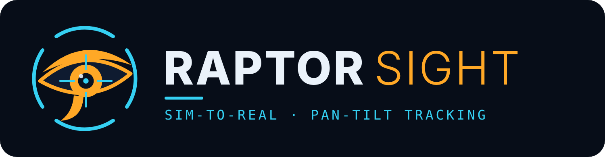

# RaptorSight

**Sim-to-real reinforcement learning for real-time pan-tilt object tracking on a Raspberry Pi 5 with the Hailo-10H AI accelerator.**

## Goal

The project builds a camera on a two-axis pan-tilt mount that keeps a detected object centred in the frame. The target can be any object the detector knows, chosen or requested by class; the current targets are people and balls, moving slowly or fast in a room.

Instead of a hand-tuned controller, the mount is steered by a small neural network policy trained with reinforcement learning entirely in a simulator. The policy is then moved to the real hardware with little or no real-world training. To get there, the simulator models the parts where simulation and reality usually differ: latency, servo imperfections and detector noise. These values are randomized during training and calibrated against measurements from the real system.

The policy's value is judged against a well-tuned PID controller on the same scenarios, by:
- tracking error,
- target-loss rate,
- re-acquisition time,
- smoothness.

```
camera → detector → tracker → observation → controller (PID or RL policy) → pan/tilt servos
```

The full design is in [PROJECT.md](PROJECT.md).

## Hardware

| Device | Role | Status |
|---|---|---|
| Raspberry Pi 5 | Runs the real-time loop: capture, tracking, controller | In use |
| Raspberry Pi AI HAT+ 2 (Hailo-10H) | Object detection | In use (PCIe Gen 3) |
| Raspberry Pi Camera Module 3 NoIR (Sony IMX708) | Tracking camera, 640×360 at 60 fps | In use (not mounted yet) |
| 2× MG90S servos + pan-tilt bracket | Pan and tilt movement | Planned |
| PCA9685 PWM driver | Servo control over I²C from the Pi | Planned |
| 5–6 V, ≥3 A supply + 1000 µF capacitor | Separate servo power | Planned |
| ESP32-S3 | Optional real-time servo driver over UART | Planned (optional) |

Only the camera and the detector run on real hardware so far. Everything after the tracker has been tested in simulation only.

## What has been done

### 1. Detector benchmark on the Hailo-10H
Ten pre-compiled Hailo-10H models were benchmarked at three levels:

| Level | What it measures |
|---|---|
| L0 | Chip speed on its own |
| L1 | Speed on 1000 recorded camera frames |
| L2 | The full live pipeline from the camera |

The models: YOLO26 n/s/m, YOLO11 n/s/m, YOLOv8m, DAMO-YOLO T/S and NanoDet. The full plan and results are in [perception/bench/plan.md](perception/bench/plan.md).

Main findings:
- **PCIe Gen 3** cuts 1.6–3 ms from every model's delay compared with Gen 2.
- **Pipelined mode:** preparing the next frame while the current one is on the chip doubles throughput at almost no added delay.
- **60 fps with the camera ISP's 640×360 stream** is the best mode. The ISP stream cuts CPU load by about two thirds.
- **The camera itself adds about 10 ms plus half the exposure time.**
- **The m-size models are too slow** for a 60 fps loop.

**Chosen detector (provisional): YOLO26n** at 60 fps, pipelined, decoding all 80 COCO classes. In the benchmark it measured 30.0 ms median and 35.6 ms 99th percentile from the sensor timestamp to boxes. The CPU load was about 30% of one core.

### 2. Live detection pipeline
`raspberrypi_camera.py` runs YOLO26n on the live camera feed at 60 fps, with a depth-2 pipeline that always takes the newest frame. Each result carries:
- the sensor timestamp and a frame number that shows skipped frames;
- exposure, gain and latency;
- boxes in pixels, and pan/tilt angles of the box centres. The angles use the FOV from the camera datasheet, which hasn't been calibrated yet.

The tracker is connected to it, with a display, click-to-lock, a class filter (`--target person`, `--target "sports ball"`) and CSV logging. For fast balls, use a short fixed exposure (`--exposure-us`, e.g. 4000) against motion blur. A 57-second live run logged 60 fps with no skipped frames and a latency of 38.4 ms median / 42.8 ms 99th percentile, from mid-exposure to the tracker's output.

### 3. Target tracking
`perception/target.py` turns each frame's boxes into the controller's input:
- **Target selection:** picks one box of the requested classes (the one closest to the centre, or a clicked one) and keeps following the same object by overlap and class. It matches each new box against where the target is predicted to be (fast balls move 30–60 px per frame), and also against where it was last seen (a ball that bounced back).
- **State estimation:** an alpha-beta filter gives the error velocity from the camera timestamps, so skipped frames are handled correctly. Its gains (0.8 / 0.5) are fast enough for kicked and thrown balls, tested in the simulator.
- **Lost targets:** while the target is missing, it predicts the position and reports how long it has been lost.
- **Jumps:** a box too far from the prediction is held back until a second box confirms it, so one wrong box can't take over the lock or kick the velocity estimate. "Too far" is 32 px plus twice the predicted motion since the last match, so a ball bouncing back is not mistaken for a jump.

`perception/analyze_track.py` summarizes the tracking logs: timing, dropouts, target switches, detector jitter, and velocity error and lag.

### 4. Simulator
`sim/` is a vectorized, box-level simulator with a Gymnasium interface. It models:

| Part | What's simulated |
|---|---|
| Pan-tilt | Two joints with angle limits |
| Servos | Command delay, 20 ms PWM frames, quantization, deadband, first-order lag, slew limit, backlash. Commands up to 360 °/s (6° per frame) |
| Camera | Pinhole projection with a mounting offset |
| Targets | People or balls at 1–5 m (a room), one kind per episode. People: 0.2–3 m/s, walking to running, with sprints; still, random walk, pacing, direction changes, bursts, stop-and-go. Balls: 0.065–0.25 m, 0.5–10 m/s; still, kicks, rolling with friction, throws under gravity that bounce. Plus occlusions |
| Detector | Box jitter, size noise, missed and false detections (balls are missed more often), minimum size, clipping at the frame edge, motion blur (the box stretches along the streak, and long streaks are missed) |
| Latency | Measured from the real system, with jitter and skipped frames. Frames are exposed on a regular sensor clock and results arrive in order, as on the Pi |
| Tracker | An exact copy of the tracker running on the Pi |

The observation, reward and termination follow PROJECT.md: the policy sees the tracker's output plus its last 6 actions, the reward weighs pan and tilt error equally per pixel, and a failed episode gets a penalty equal to staying lost. All 27 parameters are randomized per episode (size, speed and miss rate per target kind), with one difficulty setting for a curriculum. Privileged state for an asymmetric critic is also provided.

Latency, frame rate, detector noise and dropouts are based on measurements from the real system. The servo parameters are MG90S estimates.

The simulator runs at about 106,000 environment-steps per second with 1024 environments on the Pi 5.

### 5. PID baseline (in simulation)
`eval/` contains:
- **`pid.py`:** a per-axis PID controller with anti-windup and lost-target handling, using only the information available on the real system. While following the tracker's prediction of a lost target, it subtracts the turn it has already commanded.
- **`evaluate.py`:** fixed test scenarios and the evaluation metrics: 512 episodes per scenario, with 95% confidence intervals. All controllers see exactly the same episodes, and `compare()` pairs them for a direct A-vs-B difference.
- **`tune_pid.py`:** a gain search in the simulator over kp, ki, kd, the integral limit and the lost-target follow time.

Tuned gains: kp 0.256, ki 0.561, kd 0.014, integral limit 0.89°, follow time 0.08 s. On held-out test scenarios (people and balls, 512 episodes each):

| Controller | Mean score | Step test settling time |
|---|---|---|
| No action | −0.794 ± 0.004 | does not settle |
| P controller (gain 0.3) | −0.122 ± 0.005 | 0.98 s |
| **Tuned PID** | **−0.046 ± 0.005** | **1.00 s** |

Paired over the same episodes, the tuned PID beats the P controller by +0.076 ± 0.004. With nominal parameters, it never loses a target and keeps it within about 8–16 px (people) and 11–27 px (balls). With full randomization, it fails 9–21% of the 20-second episodes with moving people and 34–49% with balls, depending on the motion type; a controller with perfect information fails none of them. This is the baseline the RL policy has to beat.

The tuner maximizes the reward over all scenarios; settling time is not part of it.

## Repository layout

```
perception/
  bench/             detector benchmark scripts, model list, plan and results
  target.py          target selection and state estimation
  analyze_track.py   tracking log analysis
raspberrypi_camera.py  live detection and tracking on the Pi
requirements.txt     Pi packages; requirements-train.txt for the training machine (Mac or CUDA PC)
sim/                 simulator (config, dynamics, trajectories, observation, Gymnasium env, checks)
eval/                PID baseline, test scenarios, metrics, tuning, results
test/                camera image check
PROJECT.md           full project design
```
